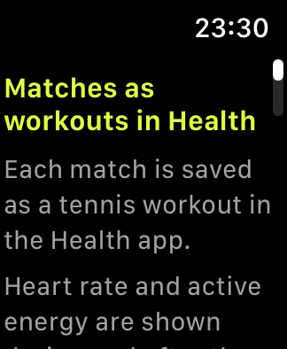
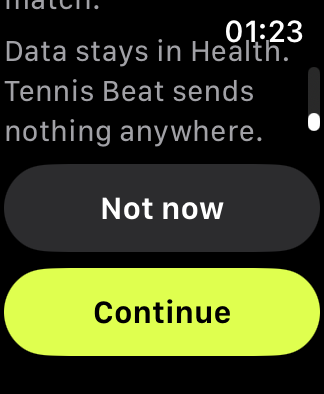

# Watch 0 — Health onboarding

- **Source:** added by spec 003 (Story 1, FR-002; research R14). There is no Figma frame: the export has only the iPhone version ([iPhone 1](iphone-1-health-permission.md)). The PNGs are simulator screenshots (Apple Watch SE 3, 40 mm, EN, default text size). **Approval:** Denys, in the 003 PR 1 review.
- **Tokens:** `../tokens.json`. **Type:** `../typography.md`. Built only from tokens and styles spec 002 already uses.

## When it shows
Before New match, at launch, while the system Health permission sheet has never been answered for this app. After Not now it returns on the next launch; once the sheet has been answered (any answer) it never returns (Q4). The app stores nothing for this: the system keeps the state.

## Layout
Black background, one `ScrollView` (no Dynamic Type cap):
1. Title "Matches as workouts in Health" (Watch/Headline, `brand/ball`), a header for VoiceOver.
2. Three lines (Watch/Body, `watch/text-secondary`): what is saved, what is read, that data stays in Health.
3. **Continue**: primary capsule (`brand/ball`, text `brand/on-ball`, ≥ 44 pt), the same style as Start on New match. It shows the system sheet; any answer leads to New match.
4. **Not now**: secondary capsule (`watch/surface-raised`, `watch/text-primary`, ≥ 44 pt), the same style as Undo on the summary. New match, no sheet.

On the 40 mm watch the buttons sit below the fold at the default size; the screen scrolls (US1 s2).

## Texts
From the spec 003 copy table (EN / PL / UK; PL drafts go to the native review, #22):

| Element | EN | PL | UK |
| --- | --- | --- | --- |
| Title | Matches as workouts in Health | Mecze jako treningi w Zdrowiu | Матчі як тренування в «Здоров’ї» |
| Line 1 | Each match is saved as a tennis workout in the Health app. | Każdy mecz zapisuje się w aplikacji Zdrowie jako trening tenisowy. | Кожен матч зберігається в програмі «Здоров’я» як тренування з тенісу. |
| Line 2 | Heart rate and active energy are shown during and after the match. | Tętno i aktywna energia są widoczne w trakcie meczu i po nim. | Пульс і активну енергію видно під час матчу й після нього. |
| Line 3 | Data stays in Health. Tennis Beat sends nothing anywhere. | Dane zostają w Zdrowiu. Tennis Beat niczego nigdzie nie wysyła. | Дані лишаються в «Здоров’ї». Tennis Beat нікуди нічого не надсилає. |
| Buttons | Continue · Not now | Dalej · Nie teraz | Продовжити · Не зараз |

No text addresses the player as «ти» or «ви».
