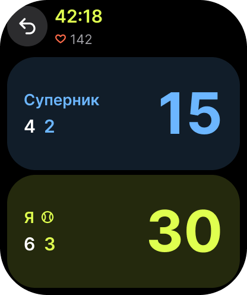

# Watch 3 — Score

- **Figma:** node `10:24` "3 · Рахунок", 208×248 pt (PNG @2x: 416×496). The UK mock-up texts are copy drafts. EN (source) and PL go into the String Catalog later, following `docs/glossary.md`.
- **Tokens:** `../tokens.json`. **Type:** `../typography.md`.

## Layout
Black background.
- **Header row:** an Undo button (circle ≈ 44 pt, `watch/surface-raised`, back-arrow glyph) at the top left. Next to it, elapsed time "42:18" (Watch/Title, `brand/ball`, monospaced digits) and below it heart rate "♡ 142" (Watch/Footnote, `status/heart` icon, `watch/text-secondary` number).
- **Two full-width tap zones** fill the rest of the screen, opponent on top and me at the bottom. Each is a rounded card, corner radius ≈ 24:
  - Opponent zone: `watch/zone-opponent` fill. Left side: label "Суперник" (Watch/Headline, `brand/opponent`); below it, sets and games "4  2" (Watch/Number; sets in `watch/text-primary`, games in `brand/opponent`). Right side: game points "15" (Watch/Score, `brand/opponent`).
  - My zone: `watch/zone-me` fill, same structure in `brand/ball`. The tennis-ball glyph next to "Я" marks the current server.
  - **Court-side pill** (approved by Denys on 2026-10-07; not in the mock-up). A small capsule next to the server's serve icon shows which half of the court the server serves from. Only the server's zone shows it.
    - The text is «справа» / «зліва» (UK), "Right" / "Left" (EN), «z prawej» / «z lewej» (PL draft), per `docs/glossary.md`.
    - The side comes from the number of points already played in the current game, or in the current tie-break: **right** when the count is even, **left** when it is odd.
    - **Exception, the No-Ad deciding point:** the receiver chooses the half, so the pill shows «на вибір» (UK), "Choice" (EN), «wybór» (PL draft) instead of a side.
    - **VoiceOver** reads a full sentence for the choice pill: «Сторону обирає приймаючий» (UK), "Receiver chooses the side" (EN), «Stronę wybiera odbierający» (PL draft) (decided by Denys on 2026-10-12).
    - Rule references: [ITF SV-03](../../rules/itf-notes.md#service-and-ends) for standard games, [ITF TB-04](../../rules/itf-notes.md#tie-break-game) for tie-breaks and match tie-breaks, [ITF NA-02](../../rules/itf-notes.md#game-scoring) for the deciding point.
  - **Game status** (decided by Denys on 2026-10-07). A status line at the top shows the game state: «Рівно» / "Deuce" / «Równowaga» at deuce in Advantage games, and «Вирішальне очко» / "Deciding point" / «Punkt decydujący» at 40–40 in No-Ad games.
- Tapping a zone scores a point for that player.

## Changes by spec 002
- **Status line** (changed by spec 002, FR-008, Q4): it shows "Deuce", "Deciding point", "Tie-break" or "Match tie-break" from the engine, and is empty otherwise; a match tie-break shows only "Match tie-break". While the match is paused it shows "Paused" instead. It sits under the elapsed time, where the heart-rate row is in the mock-up.
- **VoiceOver summary first** (changed by spec 002, Story 7 s1, s2, R2-1): the first element after the header reads the server's score first, then who serves and the side, with separate Me and Opponent strings ("30–15, I'm serving, from the left"), then the status ("…. Deuce", "…. Paused. Deuce"). The status line itself is hidden from VoiceOver. Each zone is one element: "Me, 30. 3 games, 1 set. Serving from the right.", hint "Add point for Me".
- **Court-side pill** sits in the label row, after the serve icon (changed by spec 002), so both zones keep the same height on the 40 mm watch.
- **Heart-rate row** is hidden in spec 002 (changed by spec 002); spec 003 adds it.

## Components
- Player tap zone (label, server glyph, sets, games, point score).
- Round icon button (Undo).
- Timer and heart-rate header (heart rate from spec 003).

## Texts (UK)
| Element | Text |
| --- | --- |
| Zone labels | Суперник · Я |
| Court-side pill | справа · зліва · на вибір (EN: Right · Left · Choice; PL: z prawej · z lewej · wybór) |
| Choice pill, VoiceOver | Сторону обирає приймаючий (EN: Receiver chooses the side; PL: Stronę wybiera odbierający) |
| Game status | Рівно · Вирішальне очко (EN: Deuce · Deciding point; PL: Równowaga · Punkt decydujący) |
| Example values | 42:18 · 142 · 4 2 / 6 3 · 15 / 30 |

## Notes for the spec
- The deuce/ad side indicator the plan requires is the court-side pill above.
- No-Ad deciding point: decided by Denys on 2026-10-07. The pill shows "Choice" (ITF NA-02), and the status line shows "Deciding point".
- VoiceOver reads the court side together with the server. On the deciding point it reads "Receiver chooses the side" instead of the side.
- The server is shown with a glyph, not only colour. VoiceOver must read the server and the full score.
- The heart-rate row is hidden when there is no Health permission.
