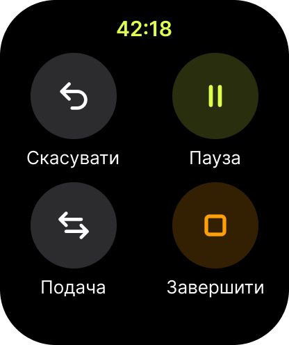

# Watch 4 — Controls

- **Figma:** node `10:60` "4 · Керування", 208×248 pt (PNG @2x: 416×496). The UK mock-up texts are copy drafts. EN (source) and PL go into the String Catalog later, following `docs/glossary.md`.
- **Tokens:** `../tokens.json`. **Type:** `../typography.md`.

## Layout
Black background. Elapsed time "42:18" centred at the top (Watch/Title, `brand/ball`). Below it, a 2×2 grid of round buttons (≈ 64 pt), each with a label underneath (Watch/Body, `watch/text-primary`):
| Position | Button | Fill | Glyph colour |
| --- | --- | --- | --- |
| Top left | Undo | `watch/surface-raised` | white |
| Top right | Pause | `watch/control-pause` | `brand/ball` |
| Bottom left | Server swap (⇆) | `watch/surface-raised` | white |
| Bottom right | End | `watch/control-end` | `status/end` (stop square) |

## Changes by spec 002
- **Server** (changed by spec 002, Assumptions, Story 4 s9): the "Подача" / Server control is the first-server correction [ITF CE-02](../../rules/itf-notes.md), not a Rule 27 order-of-service fix (CE-01). It records a correction to the other player; the whole match is recomputed and the score doesn't change. There is no confirmation, and Undo reverts it. VoiceOver announces the new server.
- **Pause / Resume** (changed by spec 002, Story 4 s5, s6): while paused the button reads Resume («Продовжити», «Wznów») with a play glyph. The score screen shows "Paused" in the status line and dims the zones (Q4).
- **End** (changed by spec 002, Story 4 s11..s13): it opens the "End match?" confirmation («Завершити матч?», «Zakończyć mecz?») with a destructive "End match" button and the system Cancel. With no point played, confirming discards the match and opens New match.
- **Undo** is dimmed and announced unavailable when there is nothing to undo (Story 4 s3).
- The page scrolls, so large text never clips (FR-025).

## Components
- Round control button with a label.

## Texts (UK)
| Element | Text |
| --- | --- |
| Labels | Скасувати · Пауза · Подача · Завершити |

## Notes for the spec
- "End" needs a confirmation (HIG, plan). The glossary label is "Завершити матч", shortened here to "Завершити".
- ~~The "Подача" (manual server swap) control is not in the plan's MVP list. The spec must decide whether to keep it and how it interacts with the event log.~~ Decided in spec 002: it is the first-server correction (ITF CE-02), recorded as an event that Undo removes (changed by spec 002).
