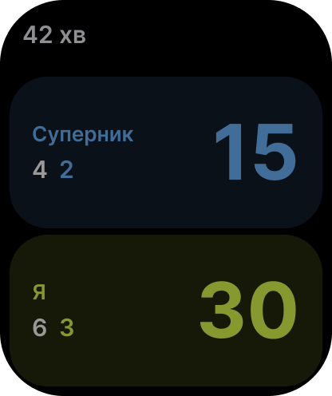

# Watch 5 — Always On

- **Figma:** node `10:90` "5 · Always On", 208×248 pt (PNG @2x: 416×496). The UK mock-up texts are copy drafts. EN (source) and PL go into the String Catalog later, following `docs/glossary.md`.
- **Tokens:** `../tokens.json`. **Type:** `../typography.md`.

## Layout
The same structure as **Watch 3 — Score**, dimmed for Always On:
- The header shows minutes only, "42 хв" (Watch/Title, `watch/text-tertiary` #8E8E93). There are no seconds, no Undo button and no heart rate.
- The zone fills and score colours are darker, lower-opacity versions of `brand/opponent` and `brand/ball`. The current games are in the dimmed player colour, as the points are; the completed sets are in grey (`watch/text-secondary`).
- No server glyph is shown.

- **Changed by spec 002 (Q8, R1-9):** the court-side pill and the status line are hidden too, not only the server glyph.
- **Colours (Denys, #24 decisions, 2026-10-15):** the games follow the PNG (dimmed player colour) and the header is `watch/text-tertiary`, as the PNG samples; an earlier build had grey games and a `text-secondary` header.
- **Colours as built:** the dimmed player colours are `brand/opponent` and `brand/ball` at 60 % opacity (#416D99, #86992F on black, as sampled from the PNG), and the zone fills the same colours at 10 % (#0A1119, #161908).

## Texts (UK)
| Element | Text |
| --- | --- |
| Header | 42 хв: whole elapsed minutes, rounded down, in the system's abbreviated format (`Duration.formatted(.units(allowed: [.minutes], width: .abbreviated))`). No plural variations: the abbreviation doesn't change with the number (changed by spec 002, R1-8). |

## Notes for the spec
- HIG and the device checklist: no seconds or animations, and the score must stay readable.
- Leaving out the server glyph was confirmed by the spec (Q8).
