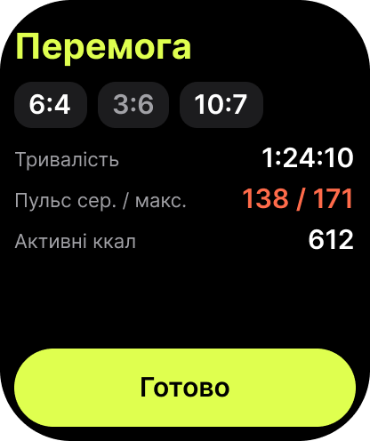

# Watch 6 — Summary

- **Figma:** node `10:117` "6 · Підсумок", 208×248 pt (PNG @2x: 416×496). The UK mock-up texts are copy drafts. EN (source) and PL go into the String Catalog later, following `docs/glossary.md`.
- **Tokens:** `../tokens.json`. **Type:** `../typography.md`.

## Layout
Black background.
1. The result title "Перемога" (Watch/Large Title, `brand/ball`).
2. A row of set-score chips ("6:4", "3:6", "10:7") on `watch/surface-raised`. Sets I lost use `watch/text-tertiary`; sets I won use `watch/text-primary`.
3. Key–value rows: label (Watch/Body, `watch/text-secondary`) on the left, value (Watch/Number style, right-aligned) on the right:
   - Тривалість: 1:24:10
   - Пульс сер. / макс.: 138 / 171 (`status/heart`)
   - Активні ккал: 612
4. A primary capsule button "Готово" (`brand/ball`).

## Changes by spec 002
- **Undo under Done** (changed by spec 002, Q7, Story 5 s9): a secondary capsule button "Undo" («Скасувати», «Cofnij») on `watch/surface-raised` under Done. It removes the match-winning point or the early end and returns to the score screen; the time on the summary is not counted.
- **Unfinished chip** (changed by spec 002, Q5, Story 5 s5): after an early end during a set, a chip with the current games and an asterisk ("3:2*"); during a match tie-break, its points ("7:5*"). VoiceOver reads it as unfinished. No chip for a set in which no point was played.
- **Title** for an early end: "Match ended early" («Матч перервано», «Mecz przerwany»), never Win or Loss (Story 5 s3).
- **VoiceOver chips** (Story 5 s6, R2-4): "Set 2: 3–6, lost"; a match tie-break reads "Match tie-break: 10–7, won".
- **Heart-rate and kcal rows are hidden** in spec 002 (changed by spec 002); spec 003 decides them with HealthKit. Duration is the only row.
- The chips wrap at large text sizes, and the whole summary scrolls.

## Texts (UK)
| Element | Text |
| --- | --- |
| Title | Перемога / Поразка |
| Rows | Тривалість · Пульс сер. / макс. · Активні ккал |
| Buttons | Готово · Скасувати (spec 002) |

## Notes for the spec
- The match tie-break is shown as a "10:7" chip (see ITF MT-05, a Not covered decision).
- The heart-rate and calories rows come from HealthKit and are hidden without permission. Active kcal is not in the plan's summary list (duration and average/max heart rate), so the spec must confirm it.
- Lost sets are dimmed, but the chip order also carries the meaning, and VoiceOver must read the full scores.
